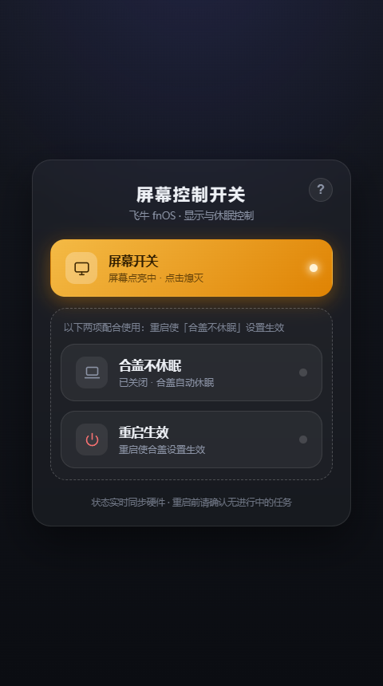

# 屏幕控制开关 · ScreenCtl for fnOS

> 飞牛 fnOS **原生 fpk 应用**。把终端里的屏幕 / 休眠管理命令做成三个按钮，打开即用。
> 零第三方依赖、零构建工具链，单个 fpk 仅约 21 KB，安装后启动 < 1 秒。
> 仓库：<https://github.com/billypala/screenctl-fnos>

根据飞牛官方视频教程开发，让大家无需在终端输入命令，点击按钮即可快速实现：**实时检测并控制屏幕开关**、**合盖不休眠**、**重启使合盖设置生效**。右上角「?」内有完整使用说明与 GitHub 主页链接。

---

## 功能特性

| 按钮 | 作用 | 底层命令 |
| --- | --- | --- |
| **屏幕开关** | 点亮 / 熄灭物理屏幕，按钮状态 = 屏幕真实状态 | `setterm --blank poke/force --term linux </dev/tty1` |
| **合盖不休眠** | 开：合盖不睡眠；关：还原默认合盖休眠 | 改 `/etc/systemd/logind.conf` 三个 `HandleLidSwitch*` 为 `=ignore` + `systemctl restart systemd-logind`（首次自动备份，关闭自动还原） |
| **重启生效** | 重启设备，使合盖不休眠设置彻底生效 | `systemctl reboot -i` |

- **真实状态检测**：打开应用即读取 `/sys/class/graphics/fb0/blank`（0=点亮、1=熄灭），屏幕按钮与硬件真实状态始终一致；sysfs 不可用时回退状态文件、兜底点亮。
- **重启后自动同步**：点击「重启生效」后设备重启期间前端每 3 秒探测，设备恢复即自动刷新并拉取最新真实状态——重启后屏幕是开的，按钮就显示"开"。
- **按钮即状态**：开 = 彩色发光（灯亮），关 = 灰色；合盖状态直接读系统 `logind.conf`，永不漂移。
- **仅管理员可操作**：经 fnOS 统一网关 `X-Trim-Isadmin` 校验，非管理员打开时操作返回 403。
- **零依赖**：后端只用 `node:http`，前端是单文件原生 JS + CSS，**不需要 `npm install`**；复用 fnOS 统一网关（`/app/screenctl`）与 Unix Socket，不占用额外端口。
- **响应式界面**：适配桌面与移动端，深浅色自动跟随。

## 界面预览



> 更多截图见 [`assets/`](assets/)：`v101-default.png`（默认态）、`help-2-modal.png`（帮助弹窗）、`ui-1/2/3-*.png`（开关点亮态与移动端）。

## 安装

从 [Releases](https://github.com/billypala/screenctl-fnos/releases/latest) 下载 `screenctl.fpk`，在 fnOS 设备上进入 **应用中心 → 手动安装** 选择该文件。

- 要求 fnOS ≥ **1.2.0**；依赖应用中心的 `nodejs_v22` 运行时（安装时自动解析）。
- 仓库内同时保留一份构建产物：[`publish/screenctl.fpk`](publish/screenctl.fpk)。

> **升级提示**：从旧版本升级会自动重新生成 sudo 授权；卸载应用不会还原 `/etc/systemd/logind.conf`（备份文件 `logind.conf.screenctl.bak` 会保留在 NAS 上）。

## 工作原理

### 1. 屏幕状态：读帧缓冲真实状态

`setterm --blank force/poke` 经 TIOCLINUX ioctl 作用于 `/dev/tty1` 的 tty，实测与帧缓冲节点映射一致：

- `poke`（点亮）→ `/sys/class/graphics/fb0/blank = 0`
- `force`（熄灭）→ `/sys/class/graphics/fb0/blank = 1`

`server.js` 的 `readScreenState()` 直接读该节点，因此按钮永远反映屏幕真实状态；只有该节点不可用（无帧缓冲控制台的设备）时才回退到状态文件缓存。

### 2. 权限模型：sudoers 白名单最小授权

应用以专用用户 `screenctl` 运行（run-as=package，无 root），而 setterm 写 tty、改 `logind.conf`、`systemctl` 都需要 root。方案：

- 包内携带 `server/priv-helper.sh`，`cmd/install_callback`（以 root 执行）写入 `/etc/sudoers.d/90-screenctl`，**只授权这一个脚本的真实路径**：
  ```
  screenctl ALL=(root) NOPASSWD: /vol1/@appcenter/screenctl/server/priv-helper.sh
  ```
- install_callback 会多候选路径探测 helper 真实路径（`readlink -f`），`visudo -cf` 仅做语法校验、**不阻断**，随后始终落盘授权——避免因校验误判导致按钮永久失去提权能力。
- `cmd/uninstall_callback` 卸载时移除该文件；`cmd/upgrade_callback` 升级时重新授权（路径可能变化）。

> 安全说明：白名单意味着 `screenctl` 用户可通过修改该 helper 脚本获得 root。个人 NAS 场景可接受，**请勿分发到不受信任的环境**。

### 3. 合盖不休眠：以系统文件为准 + 双保险还原

- 状态判定：直接读 `/etc/systemd/logind.conf`，三个键全部为未注释 `=ignore` 才算开启，与按钮零漂移。
- 开启：首次修改前 `cp` 备份原文件，再把三行改为未注释 `=ignore`，`restart systemd-logind` 生效；键缺失则追加到 `[Login]` 段。
- 关闭：优先用备份还原，再兜底把残留的 `=ignore` 行注释掉——即使备份被手动改过也能回到默认。

### 4. 服务与网关

`cmd/main` 负责 start/stop/status 生命周期（pid 文件判据、卡死自愈）。服务以 Unix Socket 监听，fnOS 统一网关把 `/app/screenctl` 转发进来，并注入 `X-Trim-Isadmin` 等头。带网关前缀的静态路径统一 SPA 回退 `index.html`。

## 从源码构建

```bash
# 1. 生成应用图标（手写 PNG 编码器，零依赖）
node scripts/make-icons.js

# 2. 打包 fpk（需要 fnpack，可用 FNPACK_BIN 指定路径）
FNPACK_BIN=/path/to/fnpack node scripts/build.js
# 产物：publish/screenctl.fpk
```

`scripts/build.js` 会把 `src/` 装配进 `apps/screenctl/app/server`、强制把 shell 脚本转为 LF、补可执行位，再调用 `fnpack build --directory apps/screenctl` 打包。

## 本地测试

```bash
# mock 冒烟：不执行真实特权命令，本地验证 HTTP 与 UI
SCREENCTL_MOCK=1 PORT=5092 DATA_DIR=.testdata LOGIND_CONF=.testdata/logind.conf node src/server.js

# helper 逻辑本地真跑（Git Bash 可直接验证 sed 备份/还原/追加）
SCREENCTL_CONF=.testdata/logind.conf bash src/priv-helper.sh lid-on

# Playwright UI 截图与交互验证（需指定 chromium 可执行文件路径）
CHROME_PATH=/path/to/chrome PW_PATH=/path/to/playwright-core node scripts/ui-test.js
```

## 目录结构

```
apps/screenctl/              # fpk 包骨架
├── manifest                 # 应用清单（version / display_name / maintainer 等）
├── cmd/                     # 9 个生命周期钩子（main + install/upgrade/uninstall 等 callback）
├── config/  wizard/  app/ui/ # 权限声明 / 安装向导 / 桌面图标（源文件）
└── app/server/              # 运行时服务（由 build.js 从 src/ 生成，不入库）
src/server.js                # HTTP 服务（node:http 零依赖；Unix Socket / PORT 双模式）
src/priv-helper.sh           # 特权助手（screen-on/off、lid-on/off、reboot）
src/public/index.html        # 单文件前端（原生 JS + CSS，含帮助弹窗）
scripts/build.js             # 装配 + LF 转换 + fnpack 打包
scripts/make-icons.js        # 手写 PNG 编码器生成图标（零依赖）
scripts/ui-test.js           # Playwright UI 截图与交互验证
assets/                      # 界面截图（README 用图）
publish/screenctl.fpk        # 构建产物（与 Release 保持一致）
```

## 更新日志

### 1.0.1
- 开屏即**实时检测屏幕真实状态**（读 `/sys/class/graphics/fb0/blank`，0=点亮/1=熄灭），按钮与硬件状态始终一致；sysfs 不可用时回退状态文件。
- 重启后前端自动回连刷新，同步重启后的最新真实状态。
- 应用改名「屏幕控制开关」；重启按钮改名「重启生效」并与「合盖不休眠」用虚线圈为一组（重启使合盖设置生效）。

### 1.0.0（rev.2）
- 首个可装版本：屏幕点亮/熄灭、合盖不休眠开关、一键重启三个控制；首次开启合盖不休眠自动备份 `logind.conf`，关闭还原默认。
- 修复 sudoers 授权在安装期被 `visudo` 误判阻断、导致按钮报 `sudo: a password is required` 的问题（多候选路径探测 + 非阻断校验 + 始终落盘）。
- 新增右上角「?」帮助弹窗（三步用法、各按钮命令与前置条件、GitHub 主页链接）。

## 维护者

**billypala** — <https://github.com/billypala>

## License

MIT
